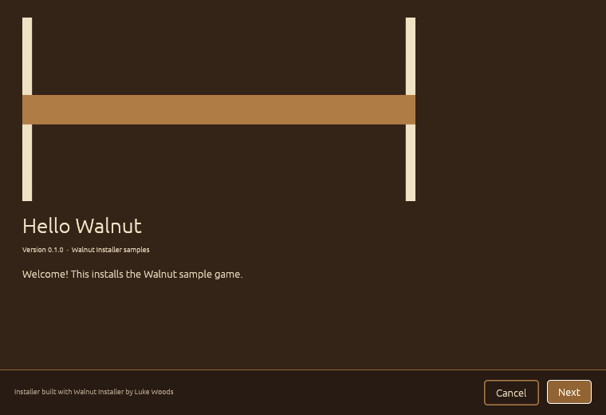
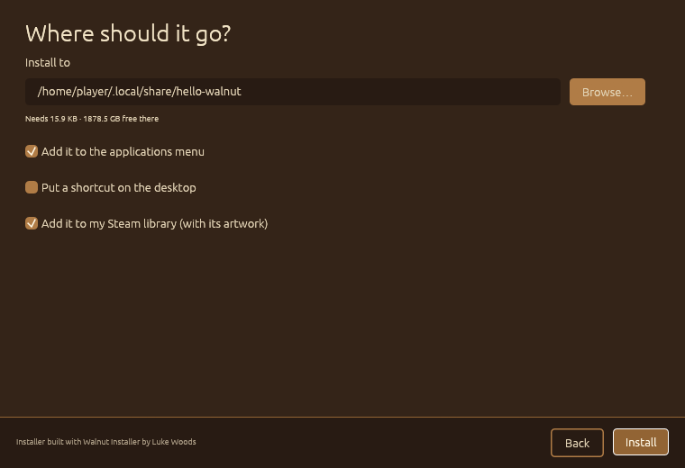
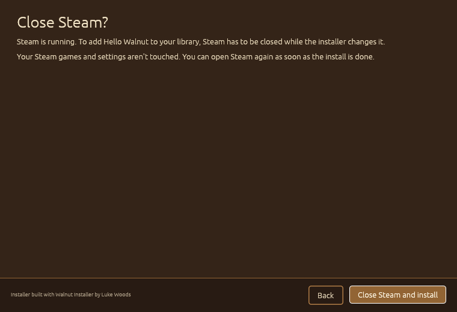
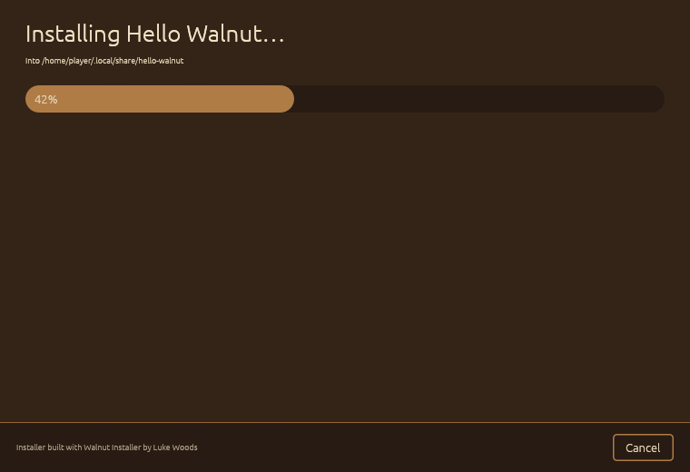
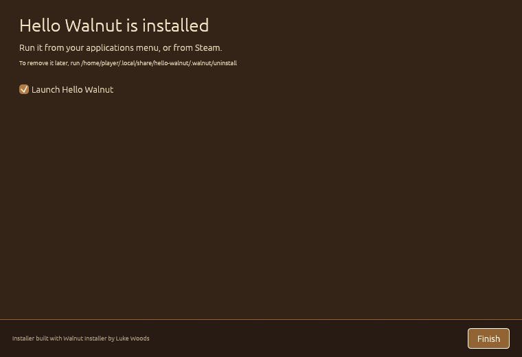
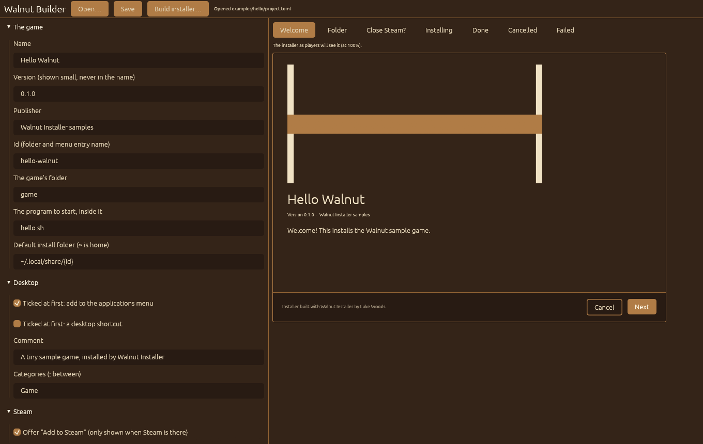
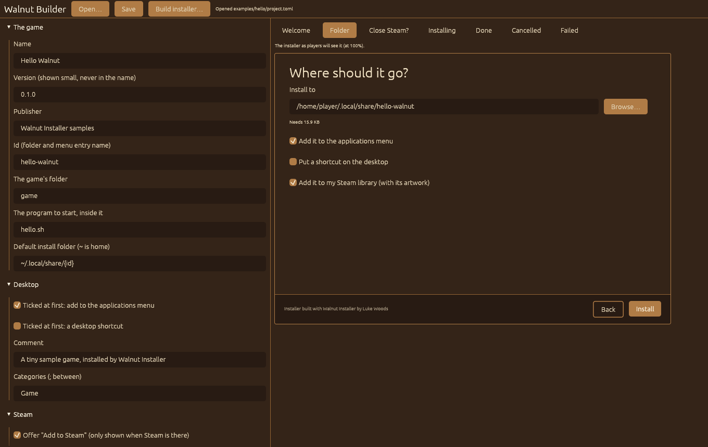

# Walnut Installer

**A free, open-source way to ship a Linux game as one friendly installer file.**

Players download one file, run it, and get what Windows players take for granted: a welcome screen, a folder picker, a progress bar, a Launch button, a menu entry with the game's icon, and (if they use Steam) the game in their Steam library with its artwork. No root, no sudo, no terminal required.

> Status: **milestone 3 of 5.** The core, the headless builder and a text-mode installer work and are tested. The walnut-themed installer screens (M2) and the WYSIWYG builder (M3) are next. See [docs/PLAN.md](docs/PLAN.md).

## Why

Shipping a Linux game today usually means one of these:

- **A tarball.** It works, but there are no shortcuts, no menu entry, no uninstall, and players have to know what to run.
- **AppImage or a Flatpak bundle.** They are great for apps, but they don't install into Steam and don't feel like an installer.
- **A storefront client.** Fine if you're on that store, but not when you hand out your own builds.

Walnut fills the gap: a single, self-contained installer that behaves like a good Windows installer, built from a small project file.

## Features

- **One file:** the installer program with the game appended, compressed and checksummed. A damaged or altered file is refused before anything is unpacked.
- **No root:** it installs into the player's home (default `~/.local/share/<game>`). An uninstaller is put beside the game.
- **The screens a player expects** (M2): welcome with the game's art, folder picker, progress with Cancel (rolled back cleanly), and done with a ticked **Launch** box.
- **Desktop integration:** a freedesktop `.desktop` entry and icon in the applications menu, and an optional desktop shortcut.
- **Add to Steam, in one tick, with artwork:**
  - The game appears in the player's Steam library as a non-Steam game, with its portrait, wide, hero, logo and icon art.
  - Steam has no command for this, so Walnut carefully edits the signed-in account's `shortcuts.vdf`: backed up first, never duplicated, never touching other games, and with Steam closed (it asks first).
- **A clean uninstall:** it removes exactly what it installed, including only its own Steam entry and art.
- **A builder** (M3): fill in a form, see each screen as you edit, and build. The same project file builds headless in CI:

  ```
  walnut build project.toml
  ```
- **Themable:** walnut and brass by default; every colour comes from the project file.

## Try it (milestone 1)

```sh
cargo build --release
./target/release/walnut build examples/hello/project.toml -o hello-walnut-installer
./hello-walnut-installer            # asks, with sensible defaults
~/.local/share/hello-walnut/.walnut/uninstall
```

The sample "game" is a shell script. Its placeholder art is drawn by `examples/hello/make_art.py`.

## Screenshots

The sample installer (`examples/hello`), in Walnut's default walnut-and-brass theme:

| Welcome | Folder | Close Steam? |
|---|---|---|
|  |  |  |

| Installing | Done |
|---|---|
|  |  |

At 200% scale nothing is clipped ([the Folder screen at 200%](docs/screenshots/2-folder-200pct.png)).

**Using it:**
- **Keyboard:** Enter is the main button, Esc is Back or Cancel, and Tab moves between controls.
- **Screen readers:** every control has a name (AccessKit).
- **No display, or `--text` / `--yes`:** it's the text-mode installer.

## The builder

`walnut-builder [project.toml]` is a form for every field of the project, with the installer's own screens beside it as you edit (in your colours, with your art). Art can be chosen or dropped onto its slot and is checked against Steam's sizes at once. **Build installer…** makes the same file as `walnut build`, and `walnut-builder --build project.toml -o OUT` does it headless.

| The form and the Welcome screen | The Folder screen |
|---|---|
|  |  |

## Roadmap

| Milestone | What |
|---|---|
| **M1** (done) | Core library, headless builder, text-mode installer, Steam and desktop integration, uninstall |
| **M2** (done) | The walnut-themed graphical installer screens (DPI scaling, keyboard, screen readers); text mode as the fallback |
| **M3** (done) | The WYSIWYG builder app with a live preview of every screen |
| **M4** | Release builds in CI (x86_64, then aarch64) |
| **M5** | First real user: *Gemstone: A Different Path* adopts it |

## License and credit

Apache-2.0 (see [LICENSE](LICENSE) and [NOTICE](NOTICE)). Redistributions must keep the NOTICE.

Installers show a small footer, **"Installer built with Walnut Installer by Luke Woods"**. It is on by default and a project can turn it off (`theme.show_credit = false`). A credit that could *not* be turned off would make the license non-OSI, so the switch stays.

## Contributing

See [CONTRIBUTING.md](CONTRIBUTING.md). Tests use temporary home folders and a fake Steam, never a real one.

---

Walnut Installer was made by Luke Woods. It is first used by *Gemstone: A Different Path*.
